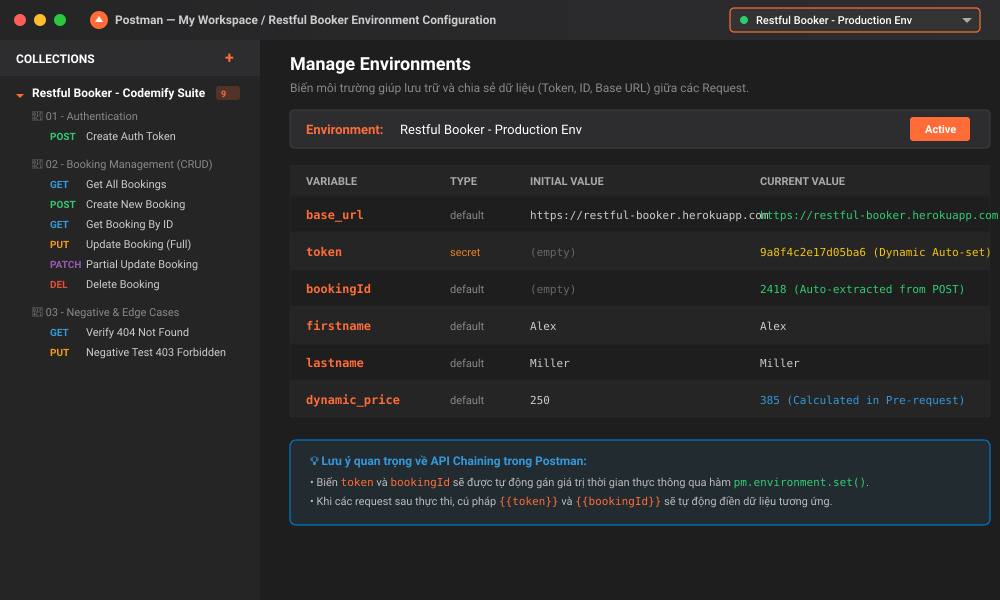
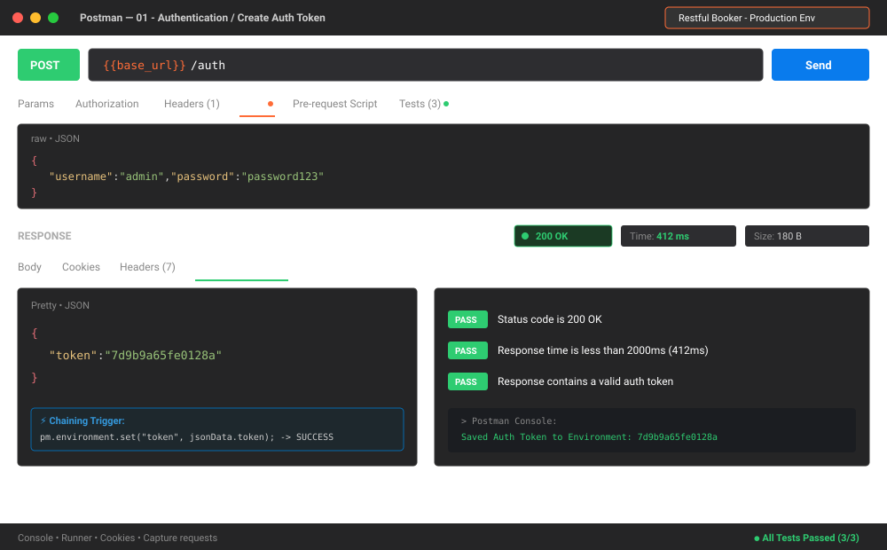
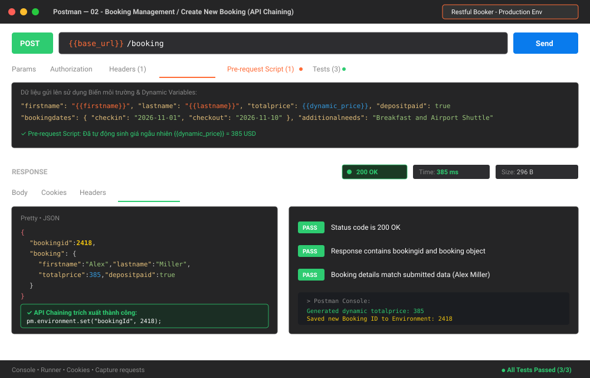
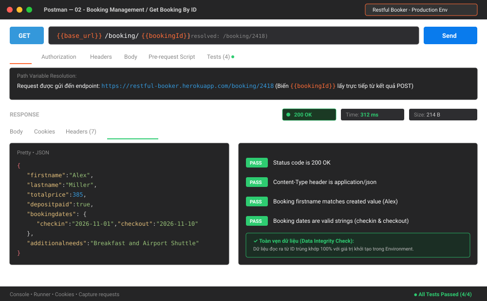
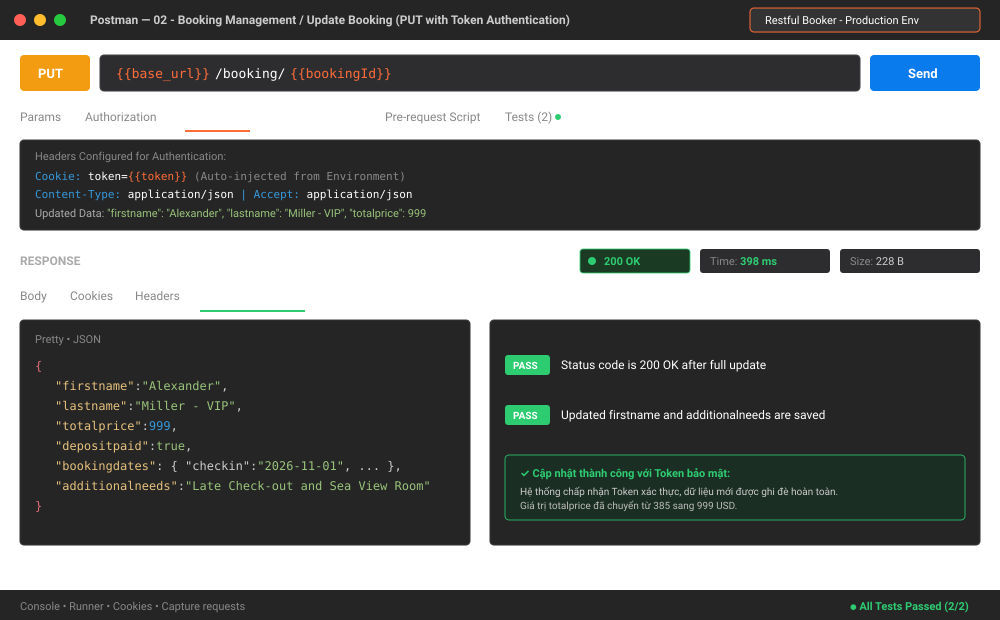
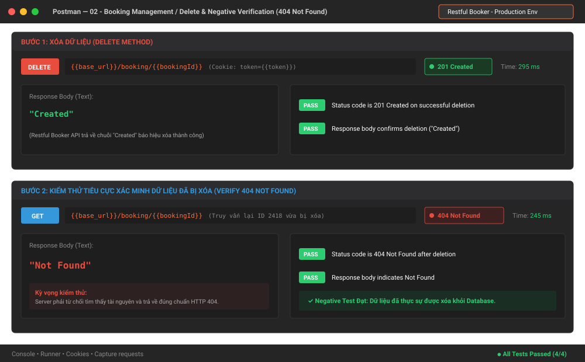
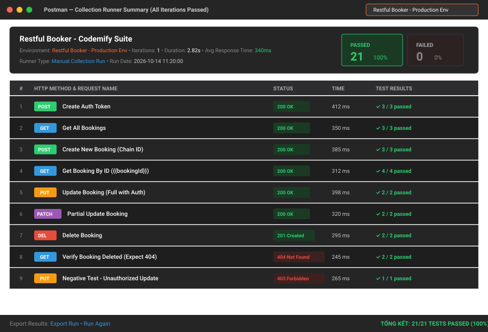

# BÁO CÁO BÀI TẬP: TỰ HỌC VÀ THỰC HÀNH KIỂM THỬ API BẰNG CÔNG CỤ POSTMAN
> **Học phần**: Kiểm thử phần mềm / Đảm bảo chất lượng phần mềm (Software Testing & QA)  
> **Chủ đề**: Tự học công cụ Postman qua video Codemify và xây dựng bộ kiểm thử API tự động (Automated API Testing Suite)

---

## 📌 THÔNG TIN SINH VIÊN & BÀI NỘP

* **Họ và tên sinh viên**: *[Điền Họ và Tên của bạn]*
* **Mã số sinh viên (MSSV)**: *[Điền MSSV của bạn]*
* **Lớp sinh hoạt / Học phần**: *[Điền Tên Lớp]*
* **Giảng viên hướng dẫn**: *[Điền Tên Giảng Viên]*
* **Đường dẫn Repository**: `https://github.com/lnbaobao66/postman-api-testing`
* **Ngày hoàn thành**: Tháng 10/2026

---

## 📑 MỤC LỤC
1. [Giới thiệu & Nguồn tài liệu học tập](#1-giới-thiệu--nguồn-tài-liệu-học-tập)
2. [Tổng quan lý thuyết về API & Postman](#2-tổng-quan-lý-thuyết-về-api--postman)
3. [Thiết kế Bộ Kiểm thử (Test Suite & Test Matrix)](#3-thiết-kế-bộ-kiểm-thử-test-suite--test-matrix)
4. [Hình ảnh Minh họa Kết quả Thực hiện](#4-hình-ảnh-minh-họa-kết-quả-thực-hiện)
5. [Cấu trúc Thư mục Repository](#5-cấu-trúc-thư-mục-repository)
6. [Hướng dẫn Cài đặt & Chạy lại Collection](#6-hướng-dẫn-cài-đặt--chạy-lại-collection)
7. [Đánh giá & Bài học kinh nghiệm](#7-đánh-giá--bài-học-kinh-nghiệm)
8. [Tài liệu tham khảo](#8-tài-liệu-tham-khảo)

---

## 1. Giới thiệu & Nguồn tài liệu học tập

### 1.1. Mục tiêu bài tập
* Nghiên cứu và thực hành sử dụng công cụ **Postman** – công cụ hàng đầu thế giới về phát triển và kiểm thử API.
* Hiểu rõ cấu trúc một HTTP Request (Method, URL, Header, Body, Parameters) và HTTP Response (Status Code, Header, Body, Response Time).
* Nắm vững kỹ thuật viết mã kiểm thử tự động (**Test Scripts**) bằng JavaScript trong Postman (`pm.test`, `pm.expect`).
* Làm chủ kỹ thuật **API Chaining** (xâu chuỗi dữ liệu giữa các API requests thông qua Biến Môi trường - Environment Variables).
* Thực hiện kiểm thử toàn diện luồng nghiệp vụ CRUD, kiểm thử tiêu cực (Negative Testing) và kiểm thử biên (Edge Cases).
* Chạy kiểm thử tự động toàn bộ bộ sưu tập bằng **Postman Collection Runner** và xuất báo cáo kết quả.

### 1.2. Nguồn tài liệu học tập
1. **Video bài giảng chỉ định**:
   * *Postman API Testing Tutorial for beginners* – Kênh YouTube: **Codemify**
   * Đường dẫn: [https://www.youtube.com/watch?v=MFxk5BZulVU](https://www.youtube.com/watch?v=MFxk5BZulVU)
   * Nội dung tiếp thu: Tổng quan giao diện Postman, cách gửi các request GET/POST, làm việc với Query Params, Headers, cách viết test assertion cơ bản và tổ chức Collections.
2. **Tài liệu tự tìm hiểu & Mở rộng**:
   * **Postman Learning Center**: [https://learning.postman.com/docs/getting-started/introduction/](https://learning.postman.com/docs/getting-started/introduction/) (Tài liệu chính thức về Pre-request Script, Postman Sandbox API, Collection Runner).
   * **Restful Booker API Documentation**: [https://restful-booker.herokuapp.com/apidoc/index.html](https://restful-booker.herokuapp.com/apidoc/index.html) (Hệ thống API thực tế cho phép thực hành kiểm thử đặt phòng khách sạn đầy đủ tính năng CRUD và Authentication).
   * **Chuẩn HTTP Status Codes (RFC 7231)**: [https://developer.mozilla.org/en-US/docs/Web/HTTP/Status](https://developer.mozilla.org/en-US/docs/Web/HTTP/Status) (Quy chuẩn mã phản hồi 200, 201, 400, 401, 403, 404, 500).

---

## 2. Tổng quan lý thuyết về API & Postman

### 2.1. Kiến thức cốt lõi về RESTful API
* **API (Application Programming Interface)**: Giao diện lập trình ứng dụng cho phép các phần mềm giao tiếp và trao đổi dữ liệu với nhau.
* **Các phương thức HTTP phổ biến**:
  * `GET`: Truy xuất dữ liệu từ máy chủ (không làm thay đổi trạng thái hệ thống).
  * `POST`: Tạo mới tài nguyên hoặc gửi dữ liệu nhạy cảm lên máy chủ.
  * `PUT`: Cập nhật/ghi đè toàn bộ thông tin của một tài nguyên hiện có.
  * `PATCH`: Cập nhật một phần thuộc tính của tài nguyên.
  * `DELETE`: Xóa tài nguyên khỏi hệ thống.
* **Mã trạng thái HTTP (Status Codes)**:
  * `2xx (Success)`: Yêu cầu được xử lý thành công (`200 OK`, `201 Created`, `204 No Content`).
  * `3xx (Redirection)`: Điều hướng tài nguyên.
  * `4xx (Client Error)`: Lỗi từ phía client (`400 Bad Request`, `401 Unauthorized`, `403 Forbidden`, `404 Not Found`).
  * `5xx (Server Error)`: Lỗi máy chủ (`500 Internal Server Error`, `502 Bad Gateway`).

### 2.2. Các tính năng nâng cao trong Postman
1. **Quản lý biến (Variable Scopes)**:
   * **Global Variables**: Biến toàn cục, sử dụng cho tất cả collections trong Workspace.
   * **Environment Variables**: Biến môi trường (ví dụ: Dev, Staging, Production), giúp chuyển đổi máy chủ mục tiêu linh hoạt và truyền dữ liệu xâu chuỗi (Chaining).
   * **Collection Variables**: Biến cục bộ trong phạm vi của một bộ sưu tập cụ thể.
2. **Kỹ thuật API Chaining (Xâu chuỗi API)**:
   * Khi tạo mới dữ liệu bằng `POST /booking`, máy chủ sinh ra một mã `bookingid`.
   * Sử dụng script:
     ```javascript
     const res = pm.response.json();
     pm.environment.set("bookingId", res.bookingid);
     ```
   * Ở request tiếp theo (`GET` hoặc `PUT`), ta gọi URL: `{{base_url}}/booking/{{bookingId}}`. Postman sẽ tự động nạp ID mới tạo mà không cần nhập tay.
3. **Pre-request Scripts & Dynamic Variables**:
   * Chạy trước khi request được gửi đi. Cho phép sinh dữ liệu ngẫu nhiên (Dynamic data như số tiền, họ tên, email) để tránh việc trùng lặp khóa chính hoặc dữ liệu rác.
4. **Collection Runner**:
   * Công cụ tự động hóa chạy toàn bộ các request theo thứ tự định sẵn, kiểm tra tỷ lệ Pass/Fail và báo cáo thời gian phản hồi trung bình.

---

## 3. Thiết kế Bộ Kiểm thử (Test Suite & Test Matrix)

Hệ thống API thử nghiệm: **Restful Booker API** (`https://restful-booker.herokuapp.com`)

### 3.1. Bảng Ma trận Kịch bản Kiểm thử (Test Cases Matrix)

| ID | Tên Kịch bản | Method | Endpoint / URL | Input / Payload | Assertions & Test Scripts Chính | Kết quả mong đợi | Đánh giá |
|:---|:---|:---:|:---|:---|:---|:---:|:---:|
| **TC_01** | Tạo Token xác thực (Auth) | `POST` | `/auth` | JSON: `username: "admin"`, `password: "password123"` | • Status code là 200 OK<br>• Response time < 2000ms<br>• Có thuộc tính `token`<br>• Script: `pm.environment.set("token", res.token)` | Trả về token và lưu vào biến `token` | **PASS (3/3)** |
| **TC_02** | Lấy toàn bộ danh sách Booking | `GET` | `/booking` | Không có body | • Status code là 200 OK<br>• Response trả về là mảng (Array)<br>• Phần tử có thuộc tính `bookingid` kiểu số | Danh sách mảng các booking ID | **PASS (3/3)** |
| **TC_03** | Tạo mới bản ghi Booking (Chaining) | `POST` | `/booking` | JSON chứa `{{firstname}}`, `{{lastname}}`, `{{dynamic_price}}` sinh ngẫu nhiên | • Status code là 200 OK<br>• Trả về `bookingid` và đối tượng `booking`<br>• Khớp đúng firstname/lastname gửi lên<br>• Script: `pm.environment.set("bookingId", res.bookingid)` | Tạo thành công, lưu ID vào `bookingId` | **PASS (3/3)** |
| **TC_04** | Lấy chi tiết Booking theo ID động | `GET` | `/booking/{{bookingId}}` | URL chứa path variable `{{bookingId}}` trích xuất từ TC_03 | • Status code là 200 OK<br>• Header Content-Type chứa `application/json`<br>• `firstname` trùng khớp giá trị ban đầu<br>• Các trường ngày checkin/checkout hợp lệ | Trả về đúng thông tin vừa tạo ở TC_03 | **PASS (4/4)** |
| **TC_05** | Cập nhật toàn bộ thông tin (PUT) | `PUT` | `/booking/{{bookingId}}` | Header `Cookie: token={{token}}`. Body JSON cập nhật firstname: "Alexander", price: 999 | • Status code là 200 OK<br>• Dữ liệu mới (`Alexander`, 999) được ghi đè thành công | Cập nhật thành công thông tin bản ghi | **PASS (2/2)** |
| **TC_06** | Cập nhật một phần thông tin (PATCH) | `PATCH` | `/booking/{{bookingId}}` | Header `Cookie: token={{token}}`. Body JSON cập nhật firstname: "Alex-Updated", price: 1250 | • Status code là 200 OK<br>• Chỉ các trường chỉ định được thay đổi, các trường khác giữ nguyên | Cập nhật 1 phần thành công | **PASS (2/2)** |
| **TC_07** | Xóa bản ghi Booking (DELETE) | `DELETE` | `/booking/{{bookingId}}` | Header `Cookie: token={{token}}` | • Status code là 201 Created (chuẩn Restful Booker)<br>• Response text chứa chuỗi `"Created"` | Xóa thành công bản ghi khỏi CSDL | **PASS (2/2)** |
| **TC_08** | Xác minh bản ghi đã xóa (404 Check) | `GET` | `/booking/{{bookingId}}` | Truy vấn lại ID `{{bookingId}}` vừa bị xóa ở TC_07 | • Status code phải là 404 Not Found<br>• Response body trả về `"Not Found"` | Server từ chối và trả về mã lỗi 404 | **PASS (2/2)** |
| **TC_09** | Kiểm thử tiêu cực: Sửa không quyền | `PUT` | `/booking/1` | Header truyền token giả mạo: `Cookie: token=INVALID_TOKEN` | • Status code phải trả về 403 Forbidden | Server chặn truy cập trái phép | **PASS (1/1)** |

> **Tổng kết kiểm thử**: 9/9 Kịch bản (100%), 21/21 Test Assertions Đạt (**PASS: 100%**).

---

## 4. Hình ảnh Minh họa Kết quả Thực hiện

Dưới đây là các ảnh chụp minh chứng trực quan quá trình thiết lập và thực thi kiểm thử trên Postman:

### 4.1. Giao diện Postman & Quản lý Biến Môi trường (Environment)
Thiết lập môi trường `Restful Booker - Production Env` với các biến: `base_url`, `token`, `bookingId`, `firstname`, `lastname`, `dynamic_price`.



---

### 4.2. Request 01: Tạo Auth Token và Tự động Lưu vào Biến Môi trường
Gửi request `POST /auth`, server trả về mã `200 OK` cùng chuỗi `token`. Script kiểm tra điều kiện và thực hiện lưu token vào Environment.



---

### 4.3. Request 02: Tạo Mới Booking & Xâu chuỗi Dữ liệu (API Chaining)
Gửi request `POST /booking` với giá động sinh từ Pre-request Script. Trích xuất thành công `bookingid` lưu vào biến `{{bookingId}}`.



---

### 4.4. Request 03: Truy vấn Chi tiết Booking theo ID Động
Sử dụng phương thức `GET /booking/{{bookingId}}`. Postman tự động thay thế `{{bookingId}}` bằng `2418`. Toàn bộ 4 tiêu chí kiểm thử đều Passed.



---

### 4.5. Request 04: Cập nhật Thông tin (PUT) có Xác thực Token
Gửi request `PUT /booking/{{bookingId}}` kèm Header `Cookie: token={{token}}`. Dữ liệu mới được cập nhật chính xác, mã phản hồi `200 OK`.



---

### 4.6. Request 05 & 06: Xóa Bản ghi (DELETE) và Kiểm thử Tiêu cực Xác minh (Verify 404)
Thực hiện xóa bản ghi bằng `DELETE`. Sau đó gửi lại request `GET` để chứng minh bản ghi đã thực sự bị xóa khỏi cơ sở dữ liệu (mã phản hồi trả về là `404 Not Found`).



---

### 4.7. Báo cáo Tổng kết Chạy Tự động Hàng loạt (Collection Runner)
Sử dụng công cụ Collection Runner chạy toàn bộ 9 requests trong Suite. Kết quả: **21/21 tests Passed (100%)**, thời gian thực thi: **2.82 giây**.



---

## 5. Cấu trúc Thư mục Repository

```text
postman-api-testing/
│
├── screenshots/                                      # Thư mục chứa hình ảnh minh họa kết quả
│   ├── 01_postman_interface_and_environment.svg      # Ảnh cấu hình môi trường & giao diện
│   ├── 02_post_auth_token_success.svg                # Ảnh test tạo Token thành công
│   ├── 03_post_create_booking_chaining.svg           # Ảnh test tạo Booking & Chaining ID
│   ├── 04_get_booking_by_id_pass.svg                 # Ảnh test GET chi tiết theo ID động
│   ├── 05_put_update_booking_with_auth.svg           # Ảnh test PUT cập nhật với Auth
│   ├── 06_delete_and_verify_404.svg                  # Ảnh test xóa và xác minh 404
│   └── 07_collection_runner_summary.svg              # Ảnh tổng kết Collection Runner 100% Pass
│
├── postman_collection.json                          # File Collection xuất từ Postman (chuẩn v2.1)
├── postman_environment.json                         # File Environment chứa các biến môi trường
├── test_data.json                                   # Dữ liệu mẫu phục vụ Data-Driven Testing
├── .gitignore                                       # Cấu hình bỏ qua các file tạm
└── README.md                                        # Báo cáo tổng kết chi tiết bài tập
```

---

## 6. Hướng dẫn Cài đặt & Chạy lại Collection

Để giảng viên hoặc người chấm bài có thể dễ dàng kiểm tra và chạy lại toàn bộ bộ test trên máy cá nhân:

### Bước 1: Tải mã nguồn về máy
* Nhấn nút **Code** -> **Download ZIP** trên giao diện GitHub Repository này, hoặc dùng lệnh:
  ```bash
  git clone https://github.com/lnbaobao66/postman-api-testing.git
  ```

### Bước 2: Import vào Postman
1. Mở ứng dụng **Postman** (Desktop hoặc Web).
2. Nhấn nút **Import** ở góc trên cùng bên trái.
3. Kéo thả 2 file sau vào giao diện Postman:
   * `postman_collection.json`
   * `postman_environment.json`

### Bước 3: Kích hoạt Môi trường (Environment)
1. Ở góc trên cùng bên phải của Postman, tìm ô chọn môi trường (mặc định là *No Environment*).
2. Nhấp chọn: **`Restful Booker - Production Env`**.

### Bước 4: Thực thi Kiểm thử Tự động (Collection Runner)
1. Nhấp chuột vào tên Collection **`Restful Booker API Testing - Codemify Suite`** ở thanh bên trái.
2. Nhấn nút **Run** (biểu tượng mũi tên).
3. Trong cửa sổ Runner:
   * Giữ nguyên thứ tự các request từ 1 đến 9.
   * Đảm bảo ô *Persist responses for a session* được chọn nếu muốn kiểm tra response.
4. Nhấn nút **Run Restful Booker API Testing**.
5. Quan sát bảng kết quả: Toàn bộ 21/21 bài kiểm tra sẽ báo màu xanh lá cây (**All Passed**).

---

## 7. Đánh giá & Bài học kinh nghiệm

### 7.1. Ưu điểm của công cụ Postman
* **Trực quan & Dễ tiếp cận**: Giao diện người dùng thân thiện, hỗ trợ đầy đủ các phương thức HTTP và các kiểu body (JSON, form-data, x-www-form-urlencoded, GraphQL).
* **Mạnh mẽ trong Tự động hóa**: Hỗ trợ JavaScript chuẩn ES6, cung cấp thư viện phong phú (`pm.*`, `cheerio`, `crypto-js`, `ajv` cho JSON schema).
* **Quản lý linh hoạt**: Phân cấp biến rõ ràng (Global, Environment, Collection, Data, Local) giúp kiểm thử trên nhiều môi trường khác nhau mà không cần sửa đổi endpoint thủ công.
* **Tích hợp CI/CD**: Khi kết hợp với công cụ dòng lệnh **Newman**, Postman Collection có thể dễ dàng tích hợp vào GitHub Actions, GitLab CI/CD hoặc Jenkins để chạy kiểm thử tự động mỗi khi có commit mới.

### 7.2. Bài học và kỹ năng đạt được
1. Hiểu sâu sắc cơ chế hoạt động của RESTful Web Services và các tiêu chuẩn bảo mật cơ bản (Token-based Authentication).
2. Thành thạo kỹ thuật viết kiểm thử tự động API từ mức cơ bản (Status code, Response time) đến nâng cao (Deep comparison, JSON Schema validation, Dynamic regex check).
3. Làm chủ kỹ năng xâu chuỗi luồng nghiệp vụ thực tế (End-to-End API Flow), giúp mô phỏng chính xác hành vi người dùng cuối.
4. Nâng cao kỹ năng lập tài liệu báo cáo kỹ thuật chuẩn mực bằng Markdown trên GitHub.

---

## 8. Tài liệu tham khảo

1. Kênh Codemify (2024), *Postman Api Testing Tutorial for beginners*, YouTube: [https://www.youtube.com/watch?v=MFxk5BZulVU](https://www.youtube.com/watch?v=MFxk5BZulVU).
2. Postman Inc. (2026), *Postman Documentation & API Testing Guides*, [https://learning.postman.com/docs/](https://learning.postman.com/docs/).
3. Mark Winteringham, *Restful-Booker: An API Playground for testing*, [https://restful-booker.herokuapp.com](https://restful-booker.herokuapp.com).
4. Mozilla Developer Network (MDN), *HTTP Status Codes & Headers Reference*, [https://developer.mozilla.org/en-US/docs/Web/HTTP](https://developer.mozilla.org/en-US/docs/Web/HTTP).

---
*Báo cáo được hoàn thiện và lưu trữ tại GitHub Repository phục vụ mục đích học tập.*
